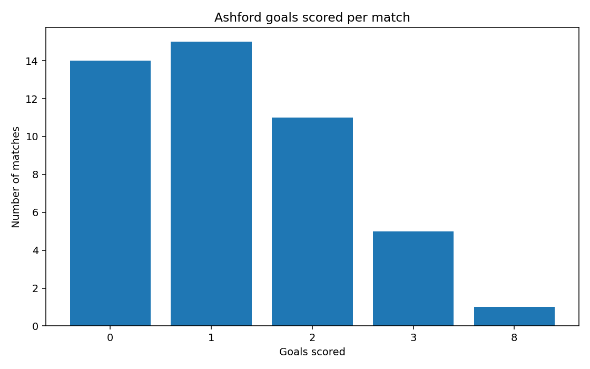
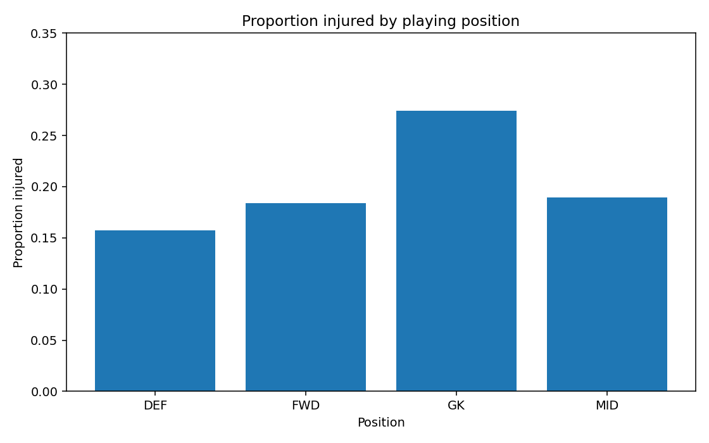
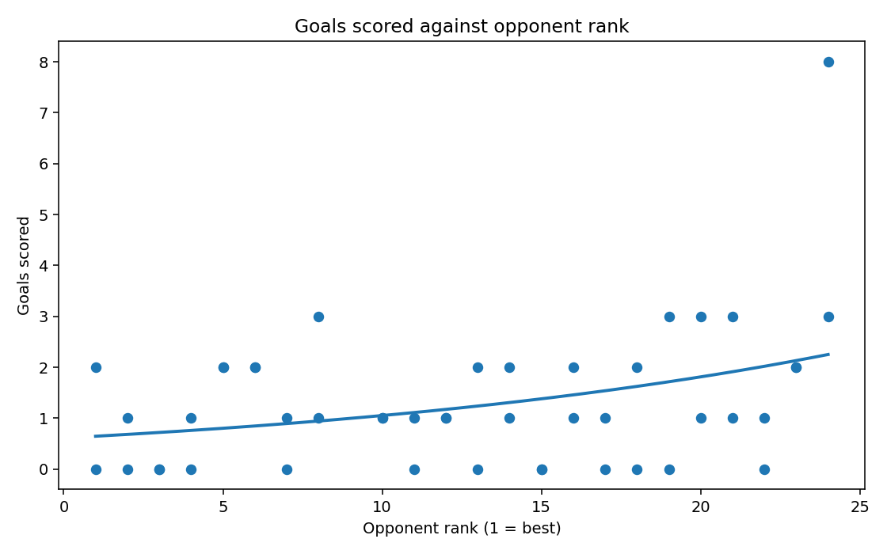

# Week 3 - Mikael: Introduction to GLMs

I looked through the player and match datasets and tried a Poisson GLM on Ashford's goals scored. This is Week 3 exploration, not our final group model.

> **Run check:** These files contain results checked against the supplied CSVs independently of R. Before submission, open the project in RStudio and run `code/week3_Mikael.R`. It will replace this results page, text output and PNG plots with the R-generated versions.

## Data checks

| Check | Result |
|---|---:|
| Players | 620 |
| Ashford matches | 46 |
| Missing values | 0 |
| Injured players | 115 |
| Matches with zero goals | 14 |
| Mean goals scored | 1.304 |
| Variance of goals scored | 1.994 |

## Possible responses

| Response | Type | Possible GLM | Possible predictor |
|---|---|---|---|
| `bmi` | Continuous | Gaussian, identity link | `age` |
| `injured` | Binary (0/1) | Binomial, logit link | `prev_injuries` |
| `goals_scored` | Count | Poisson, log link | `opponent_rank` |

## Poisson example

I tried `goals_scored ~ opponent_rank` with a Poisson family and a log link.

| Term | Estimated coefficient |
|---|---:|
| Intercept | -0.4933 |
| Opponent rank | 0.0543 |

An increase of 1 in opponent rank was associated with about **5.6% higher expected goals** in this model. A higher rank number means a lower league position. This is an association rather than a causal claim.

I also followed the IWLS formula from Question 3. Unlike the small lab example, our dataset contains zero-goal matches, so I used the mean as my starting expected goal count. The independently checked calculation converged to the same coefficients as the fitted model.

## Plots

### Goals scored per match

### Injury proportion by position

### Goals against opponent rank

## What I would check next

One match had eight goals, which could have a noticeable influence. The variance in goals is higher than the mean, so the Poisson assumption is something to check later. I have not chosen a final model for the group.

[Text results](results.txt) · [R script](../../code/week3_Mikael.R) · [Week 3 notes](../../notes/week3_Mikael_notes.md)
